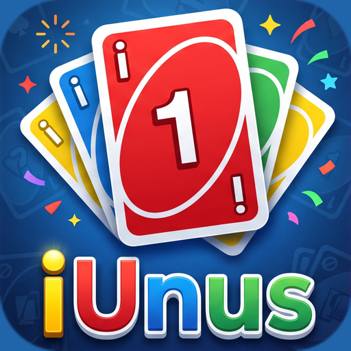

<p align="center"></p>

# 🎴 iUnus

> The classic UNO card game, natively reimagined for iOS with SwiftUI.

[Report Bug](https://github.com/VidiPT89/iUnus/issues) · [Request Feature](https://github.com/VidiPT89/iUnus/issues)

## ✨ Features

- ✅ UNO-style rules and a configurable house-rules variant — 108-card deck, 1 human with up to 9 AI opponents, Skip/Reverse/Draw Two/Wild/Wild Draw Four
- ✅ Smart AI opponents with strategic card and color selection
- ✅ Play or keep a newly drawn playable card, with the choice preserved when resuming
- ✅ Responsive table, explicit active color, accessible card buttons and legal-move markers
- ✅ Smooth, native SwiftUI animations — card dealing, playing, and draw-pile motion
- ✅ Haptic feedback on key moments (playing a card, invalid moves, UNO calls, wins)
- ✅ "UNO!" call mechanic: get caught before the next player acts, including by the AI (more forgiving on Easy)
- ✅ Saved games preserve draw/color decisions, challenges, rule set and round results
- ✅ Game Center turn-based matches, with visible save errors and retry
- ✅ Game Center welcome banner on launch and access point on the main menu (opens the Games overlay)
- ✅ Multi-round scoring up to 500 points, with round and game summary screens
- ✅ Statistics in Settings (games played/won, best streak, best score) with reset
- ✅ Runtime language switch — Português (PT-PT) and English, independent of system locale
- ✅ Dark mode, Light mode, and System mode
- ✅ Custom color identity inspired by [ividi.dev](https://ividi.dev/) — burnt orange, amber and black

## 🛠️ Tech Stack

| Category    | Technology            |
|-------------|------------------------|
| Language    | Swift 5.9+              |
| UI          | SwiftUI (iOS 16+)        |
| Architecture| MVVM                     |
| Project     | XcodeGen                 |

## 🚀 Quick Start

**Prerequisites**
- Xcode 15+
- iOS 16+ simulator or device

**Steps**

```bash
git clone https://github.com/VidiPT89/iUnus.git
cd iUnus
open iUnus.xcodeproj
```

Select the `iUnus` scheme and run on a simulator or device.

## 📖 Usage

Launch the app, choose the number of opponents from the main menu, and play a full game of UNO
against the built-in AI. Tap the language and appearance icons in Settings to switch between
PT-PT/English and Light/Dark/System mode at any time.

## 🧪 Testing

Run the shared `iUnus` scheme in Xcode (`⌘R`) or run tests (`⌘U`, iOS 17+ simulator). The app deployment target remains iOS 16. Tests (26) cover draw/color decisions, challenges, scoring, save validation and compatibility, UNO, turn cancellation, localization, and full rounds with 2/4/10 players. Layout tests attach compact/tablet captures to the test result.

To verify compilation:

```bash
xcodebuild -project iUnus.xcodeproj -scheme iUnus -destination 'generic/platform=iOS Simulator' build
```

## Review and validation limits

See [the general review](docs/2026-11-19-review.md). Game Center still requires an end-to-end check between two real accounts/devices. Online games finish after one round, call UNO automatically, and remain available in Game Center when you close the table.

## 📄 License

Distributed under the MIT License. See [LICENSE](LICENSE) for details.

## 👨‍💻 Author

**David Arsénio Martins**

🌐 Website: [ividi.dev](https://ividi.dev/)
🐙 GitHub: [@VidiPT89](https://github.com/VidiPT89/)

## 🤝 Contributing

Contributions, issues and feature requests are welcome. Feel free to check the [issues page](https://github.com/VidiPT89/iUnus/issues).

---

<p align="center">Developed by <a href="https://ividi.dev">David Arsénio Martins</a></p>
<p align="center">If you like this project, consider giving it a ⭐</p>
